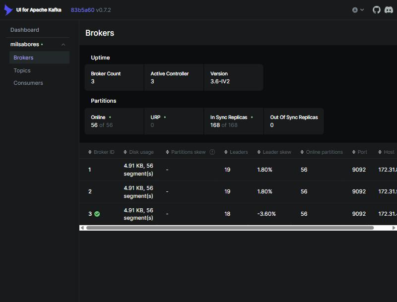
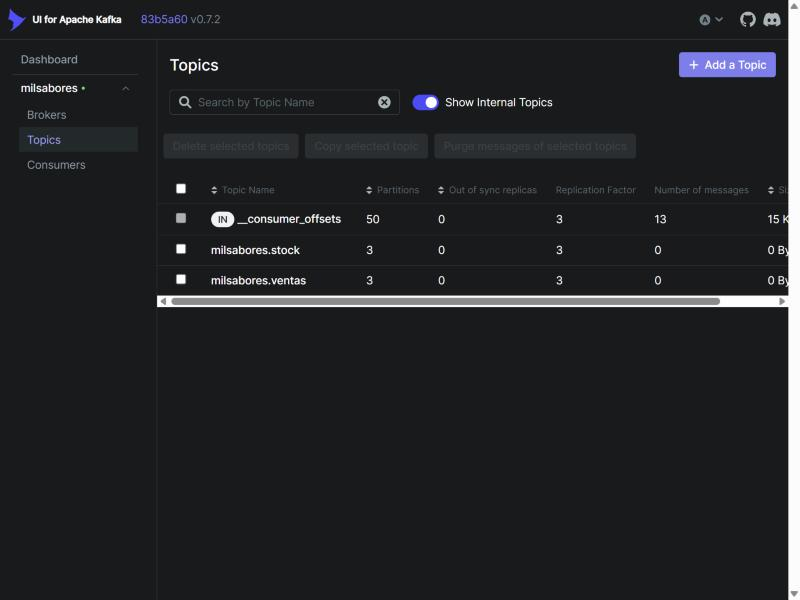
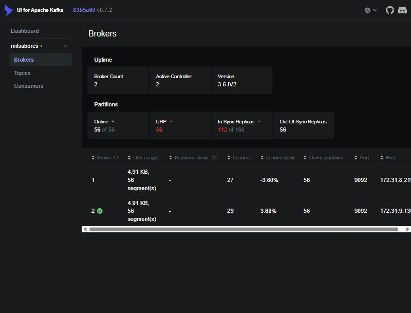
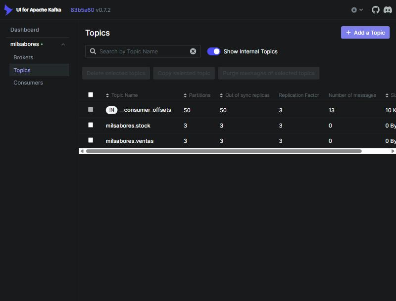
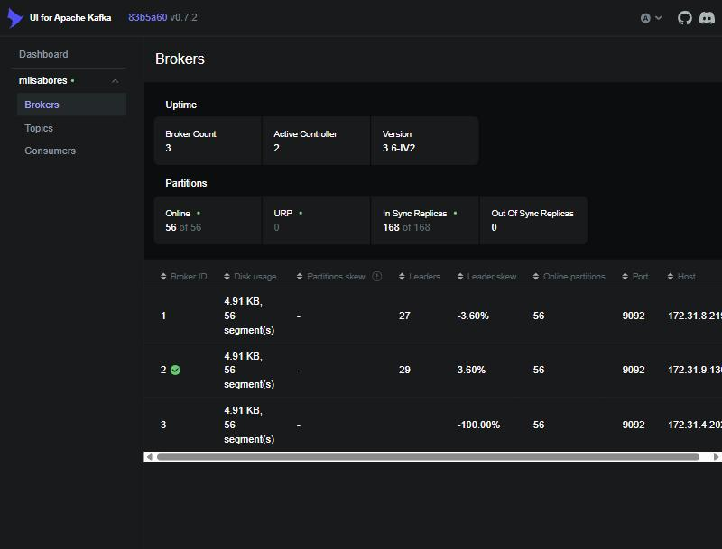

# Prueba de alta disponibilidad: caída de un broker de Kafka

Fecha: 2026-11-25. Objetivo: comprobar que el clúster de Kafka (3 brokers + 3 Zookeeper, uno por EC2 — ver [`docs/diagramas/topologia-aws-actual.svg`](diagramas/topologia-aws-actual.svg)) sigue sirviendo cuando se cae uno de los tres nodos, y que se recupera solo al volver a levantarlo.

Clúster real: `milsabores`, tópicos `milsabores.stock` y `milsabores.ventas`, ambos con 3 particiones y **factor de replicación 3**, `min.insync.replicas=2`.

## 1. Estado inicial: los 3 brokers arriba

3 brokers online, 56/56 particiones online, **168/168 réplicas in-sync**, 0 fuera de sync.



Los dos tópicos propios, sin ninguna réplica fuera de sync:



## 2. Se tumba kafka-node-3

Por SSH, en la propia EC2 del nodo 3 (IP elástica `3.226.29.156`, `KAFKA_NODE_ID=3`):

```bash
cd ~/milsabores-kafka
sudo docker compose -f docker-compose.kafka-node.yml stop
```

Resultado inmediato en Kafka-UI (unos 10 segundos después): el clúster pasa a reportar **2 brokers**, **56 particiones con under-replicated partitions (URP)**, solo 112/168 réplicas in-sync y 56 fuera de sync — pero **las 56 particiones siguen online**, ninguna se cae:



Ambos tópicos muestran 3 réplicas fuera de sync cada uno (las que vivían en el nodo caído), pero el clúster los sigue sirviendo con normalidad:



### Verificación funcional con el broker caído

Con el nodo 3 todavía abajo, se probó que la aplicación sigue funcionando end-to-end:

```bash
curl -s -o /dev/null -w "gateway health: %{http_code}\n" http://184.195.13.200:8080/actuator/health
# gateway health: 200

ssh ubuntu@184.195.13.200 \
  'cd ~/milsabores && sudo docker compose -f docker-compose.ec2.yml exec kafka-admin wget -qO- http://localhost:8087/api/kafka-admin/topics'
# [{"nombre":"milsabores.stock","particiones":3,"factorReplicacion":3,...},
#  {"nombre":"milsabores.ventas","particiones":3,"factorReplicacion":3,...}]
```

El gateway responde `200` y `kafka-admin` sigue listando los tópicos con su configuración real — la caída de un broker no interrumpe el servicio porque `min.insync.replicas=2` sigue cumpliéndose con los 2 brokers restantes.

## 3. Se levanta kafka-node-3 de nuevo

```bash
cd ~/milsabores-kafka
sudo docker compose -f docker-compose.kafka-node.yml start
```

Tras ~10 segundos, el clúster vuelve a reportar los **3 brokers**, **0 URP**, **168/168 réplicas in-sync**, **0 fuera de sync** — se auto-recuperó sin ninguna intervención manual más allá de levantar el contenedor:




(El broker 3 vuelve con `leader skew: -100%` porque no tenía ningún partition leader asignado todavía — Kafka no reelige leaders automáticamente al volver un nodo, solo pone sus réplicas al día. Esto es comportamiento esperado, no un problema: las 56 particiones ya estaban online y sirviendo desde los otros 2 brokers durante toda la caída.)

## Conclusión

- Con un broker caído de 3, el clúster sigue sirviendo sin interrupción (0 particiones offline en ningún momento).
- La aplicación (gateway, `kafka-admin`) sigue respondiendo con normalidad durante la caída.
- Al recuperar el nodo, el clúster vuelve solo al estado sano (0 URP, 0 fuera de sync) sin reiniciar nada más.
