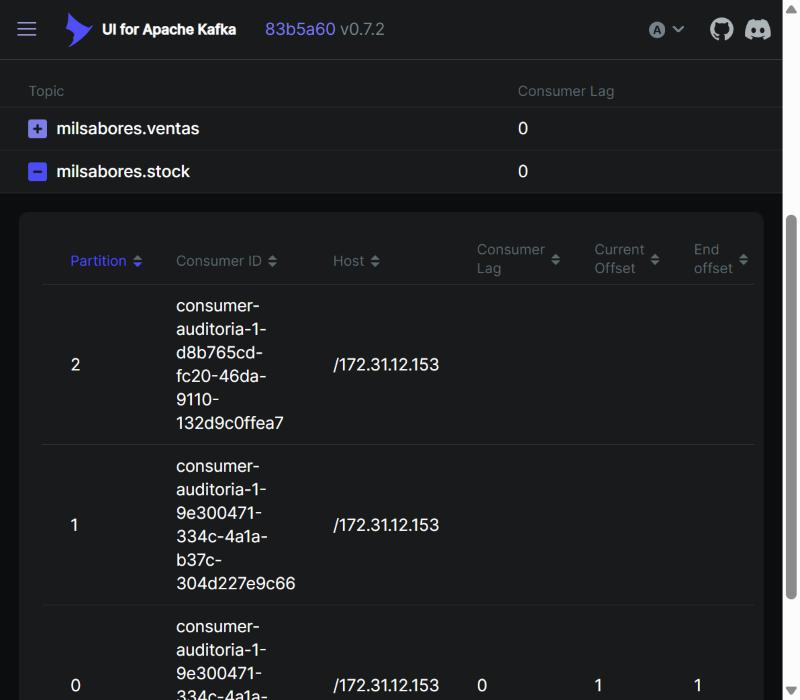
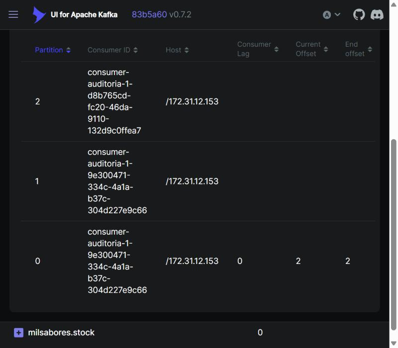

# Preparación del punto 11: offsets, lag y distribución del consumo

Fecha: 2026-11-25. Objetivo: tener listo en Kafka-UI algo real que mostrar e interpretar para el punto 11 de la pauta de apoyo ("Muestra offsets, lag y distribución del consumo (Kafka UI o CLI) y los interpreta"), y de paso quedó documentado un caso real de manejo explícito de errores (punto del IL 3.2).

## Punto de partida: por qué salían `null`

Antes de este ensayo, `milsabores.stock` y `milsabores.ventas` tenían **0 mensajes** desde que se creó el clúster (nunca había pasado una venta real por producción). Eso hace que Kafka-UI muestre `null` en `Current Offset` / `End Offset` / `Consumer Lag` por partición: no es un bug de la UI, es que no existe ningún offset committeado todavía. **Para la presentación, esto se resuelve solo apenas hagas una venta real o un mensaje de prueba** — no hay que configurar nada.

## Mensajes de prueba enviados (vía Kafka-UI → topic → Produce Message)

Para no esperar a una compra real, se mandaron dos mensajes de prueba con `ventaId=999999` (fácil de identificar como dato de prueba), usando el botón **Produce Message** de Kafka-UI con:
- **Value Serde**: String (JSON a mano, con la forma exacta de los records `StockDescontado`/`VentaRegistrada` de `kafka-topology`).
- **Header `__TypeId__`**: obligatorio — Spring Kafka's `JsonDeserializer` necesita ese header con el nombre completo de la clase (`com.milsabores.kafka.StockDescontado` / `com.milsabores.kafka.VentaRegistrada`) para saber a qué tipo deserializar. Sin él, falla (ver más abajo).

### 1) `milsabores.stock` → `StockDescontado`

```json
Key: 999999
Value: {"ventaId": 999999, "items": [{"productoCode": "TORTA-001", "cantidad": 1}]}
Headers: {"__TypeId__": "com.milsabores.kafka.StockDescontado"}
```

Quedó bien formado al primer intento. Log de ambos consumer groups:

```
ventas-service-1   | Grupo auditoria leyó milsabores.stock partición 0 offset 0 venta 999999
ventas-service-1   | Auditoría guardada: Venta 999999 con stock descontado (TORTA-001 x1)
producto-service   | Grupo notificacion leyó milsabores.stock partición 0 offset 0 venta 999999
producto-service   | Notificación guardada: Venta 999999 con stock descontado (TORTA-001 x1)
```

Resultado en Kafka-UI → Consumers → `auditoria` → `milsabores.stock` → partición 0: **Current Offset: 1, End Offset: 1, Consumer Lag: 0** (ya no `null`):



### 2) `milsabores.ventas` → `VentaRegistrada`: primer intento falló (y eso también sirve)

Al primer intento, el mensaje se mandó **sin el header `__TypeId__`** (quedó en `{}`). Resultado: ambos consumer groups lo rechazaron limpiamente, sin caerse:

```
ventas-service-1  ERROR c.milsabores.kafka.KafkaConsumerErrors : El grupo deja el aviso de milsabores.ventas partición 0 offset 0 y sigue con el siguiente
org.springframework.kafka.listener.ListenerExecutionFailedException: Listener failed
Caused by: org.springframework.kafka.support.serializer.DeserializationException: failed to deserialize
Caused by: java.lang.IllegalStateException: No type information in headers and no default type provided
```

**Esto es, en sí mismo, una demostración real del manejo explícito de errores** que pide el IL 3.2: un mensaje no reconocible se anota en el log y el grupo sigue con el siguiente, sin bloquear el consumo ni tumbar el servicio. Vale la pena mencionarlo en la presentación como evidencia adicional, junto con el punto 11.

Al segundo intento, con el header correcto, se procesó limpio en offset 1:

```
ventas-service-1   | Grupo auditoria leyó milsabores.ventas partición 0 offset 1 venta 999999
ventas-service-1   | Auditoría guardada: Venta 999999 de prueba@milsabores.cl en COMPLETADA por 10000
producto-service   | Grupo notificacion leyó milsabores.ventas partición 0 offset 1 venta 999999
producto-service   | Notificación guardada: Venta 999999 de prueba@milsabores.cl quedó en COMPLETADA por 10000
```

Kafka-UI → Consumers → `auditoria` → `milsabores.ventas` → partición 0: **Current Offset: 2, End Offset: 2, Consumer Lag: 0** (offset 0 = el mensaje descartado, offset 1 = el bueno; el offset avanza igual aunque el primero haya fallado):



## Verificación end-to-end: el flujo completo quedó trazable

```bash
curl .../api/ventas/auditoria?ventaId=999999
```
```json
[
  {"id":1,"ventaId":999999,"tipo":"STOCK_DESCONTADO","resumen":"Venta 999999 con stock descontado (TORTA-001 x1)","topic":"milsabores.stock","particion":0,"offset":0,"recibidoEn":"2026-11-25T23:43:22..."},
  {"id":2,"ventaId":999999,"tipo":"VENTA_REGISTRADA","resumen":"Venta 999999 de prueba@milsabores.cl en COMPLETADA por 10000","topic":"milsabores.ventas","particion":0,"offset":1,"recibidoEn":"2026-11-25T23:47:35..."}
]
```

Ambos avisos (stock y venta) quedaron guardados con el tópico, partición y offset exactos en los que se leyeron — la misma información que alimenta el polling del frontend en la página de resultado del checkout.

## Qué decir en la presentación (punto 11)

1. Abrir Kafka-UI → **Consumers** → mostrar los 2 grupos (`notificacion`, `auditoria`), cada uno con **Num of Topics: 2** (ambos leen los dos tópicos, con su propio offset — por eso el ensayo de HA mostraba 56 particiones con solo 2 brokers: cada grupo tiene su copia de progreso).
2. Entrar a un grupo → expandir un tópico → mostrar **Partition / Current Offset / End Offset / Consumer Lag** por partición. Interpretación: `Current Offset == End Offset` y `Lag == 0` significa que el consumidor está al día; si `Lag > 0` significa que hay mensajes nuevos que todavía no se procesan (se puede mostrar en vivo justo después de una compra: el lag sube a 1 por una fracción de segundo y vuelve a 0).
3. Mencionar que cada grupo tiene **su propio offset por tópico/partición** — `notificacion` y `auditoria` avanzan de forma independiente, aunque lean los mismos 2 tópicos (eso es justamente la "distribución del consumo" entre casos de uso).
4. Si se quiere, mencionar el caso del mensaje descartado como ejemplo de manejo explícito de errores (IL 3.2), sin que sea necesario para el punto 11 en sí.
